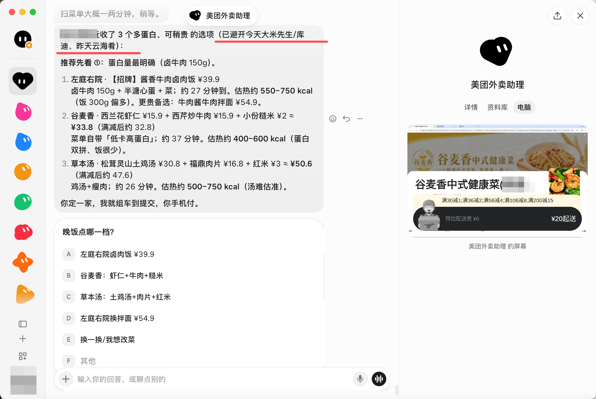
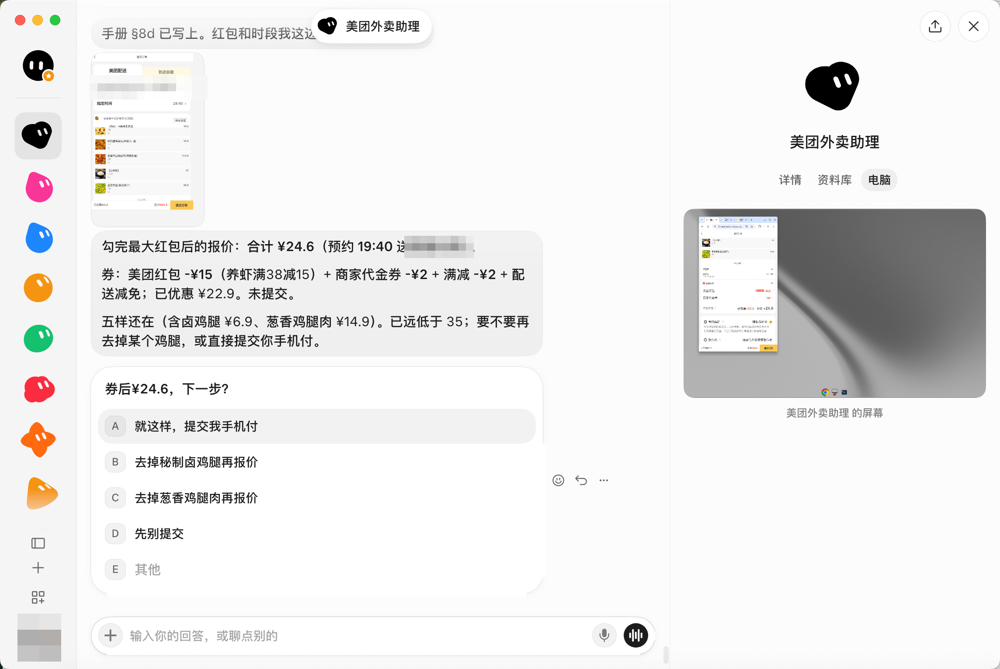
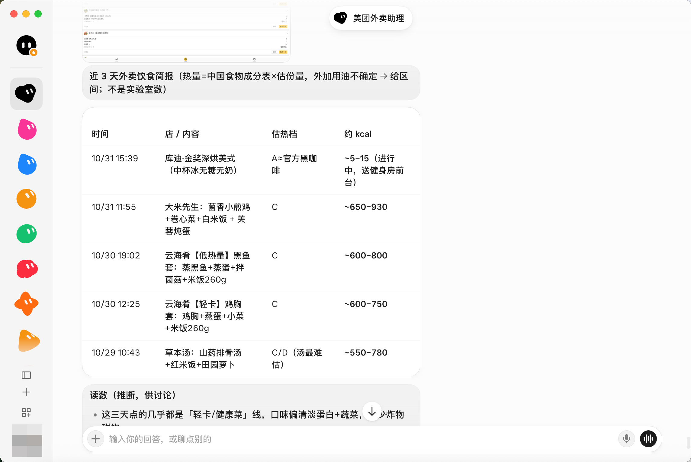
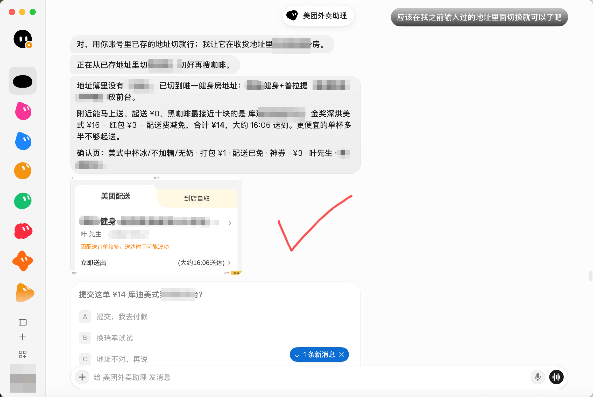
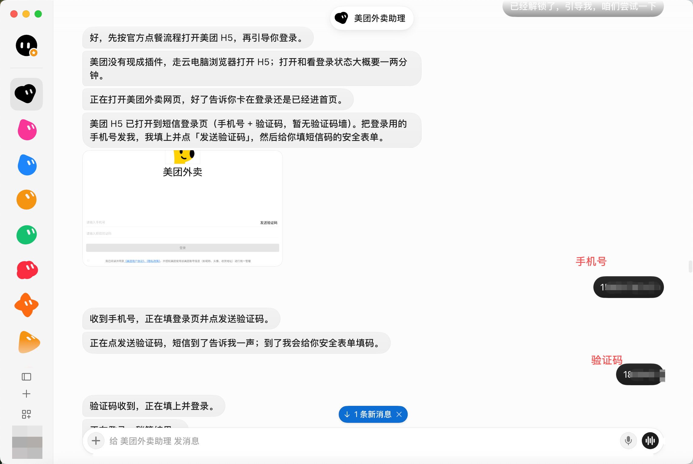
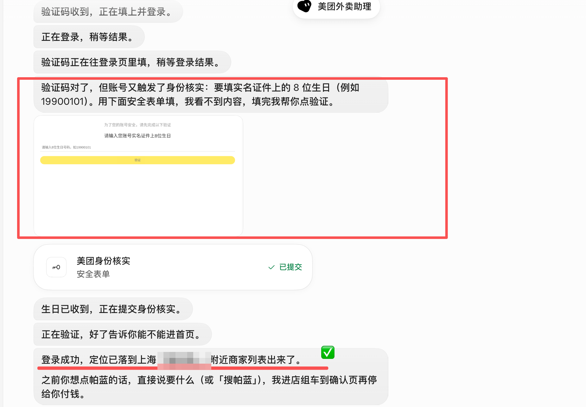
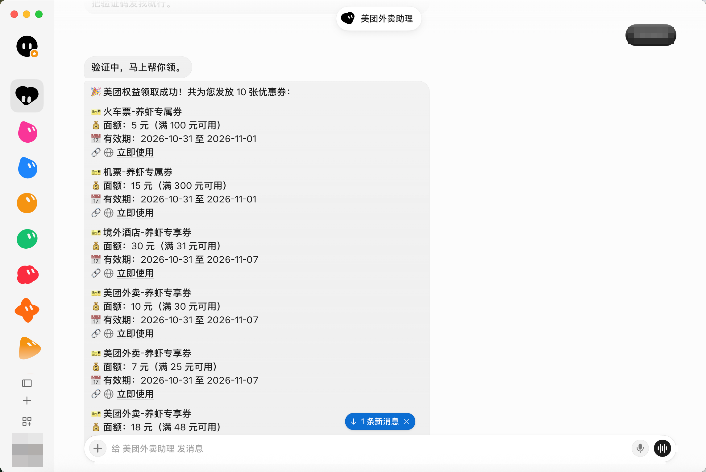
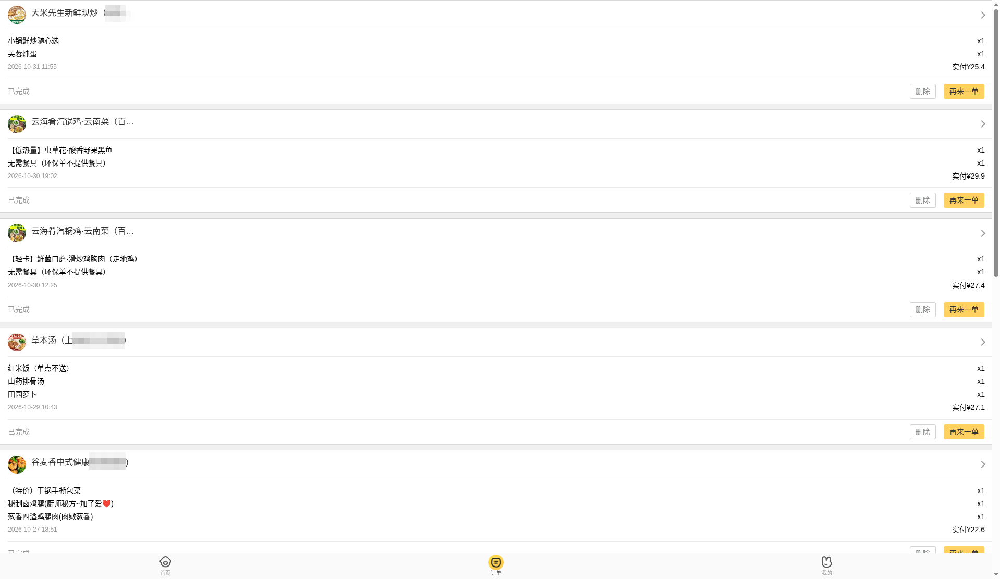
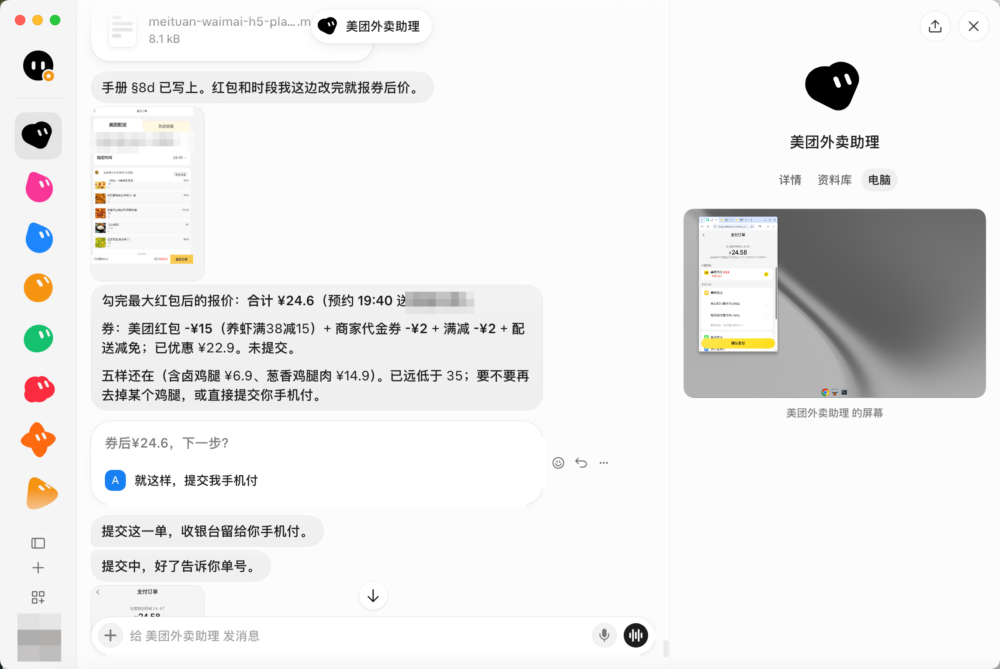
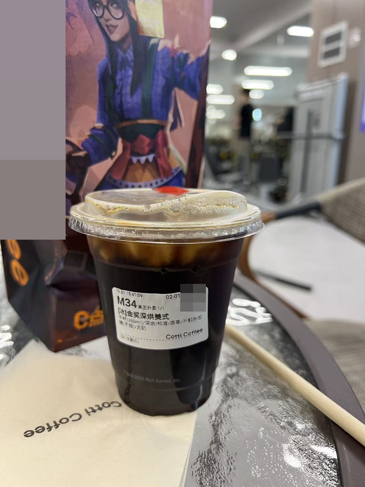

<p align="right"><strong>中文</strong> · <a href="README.en.md">English</a></p>

# grok-eats · 让 Grok Bot 帮你点美团外卖

**跟 Grok Bot 说一句“晚饭吃点高蛋白的”，它就在云电脑里打开美团外卖：读你最近的订单，挑三个选项，勾上最大的红包，把订单推到收银台。你只需要在手机上付款。**

<p align="center">
  
  
</p>
<p align="center">
  
  
</p>

<p align="center"><em>2026-10-31 Grok Bot 实测：在美团外卖点了一杯 ¥14 的美式和一顿券后 ¥24.6 的晚饭。两单都是 Grok Bot 提交，人在手机上付款。</em></p>

> **不只是 Grok Bot。** 这是一份写给 Agent 的 skill，任何能开网页的 Agent 都能用，比如 Muse 这类带浏览器的 personal agent、Claude Code + 浏览器、OpenClaw。美团外卖已实测；饿了么 H5 也是同一套思路（待实测）。

---

## 为什么要做这个

美团给个人开放的 AI 能力只有两样：**领券**和**跑腿**，外卖下单没有给个人用的接口。跑腿“帮买”能用，但要额外付跑腿费，也用不了外卖的满减和红包。

剩下的路，是让 Grok Bot 用云电脑里的浏览器去点美团外卖的 H5 网页版。真跑起来才发现，坑全在细节里：

- 红包**不会自动勾**。不勾报 ¥41.6，勾上是 ¥24.6。
- 「再来一单」**会漏菜**。原单 5 样，进购物车只剩 2 样。
- 地址它会**自己编**。地址簿里没有“XX 健身房”，它就想去地图上新建一个。
- 登录时可能**弹出身份核实**，要填实名证件上的生日。

这个仓库把 Grok Bot 一单一单踩出来的坑写成了一份 **Agent skill**：一套操作规程加四条硬规则，让 Agent 别走弯路，也别越界。

## Grok Bot 能帮你做什么

| 你说 | Grok Bot 做 |
|---|---|
| “帮我登录美团” | 用短信验证码登录；遇到身份核实走加密表单，不在聊天里要你的生日 |
| “晚饭吃什么？” | 读近 3～7 天的美团订单，避开今天吃过的，给出 2～3 个「再来一单」候选（选择题） |
| “我最近吃得怎么样？” | 出一份热量简报：每一顿给区间和依据档位，不编精确数字 |
| “就第二个” | 组车 → 勾最大红包 → 读回菜品、券、合计、地址 → 等你说“提交” |
| “提交” | 提交订单，停在收银台。你打开手机美团 →「待支付」付款 |
| 每天早上 | 配合美团官方领券 skill，自动领一次红包 |

## 四条硬规则

1. **不碰支付**：提交后就停，不输任何支付密码。
2. **不擅自提交**：把确认页读回给你看，你明确说“提交”才点。
3. **不编地址**：只用地址簿里已有的地址。
4. **不明文要敏感信息**：证件信息走加密表单，没有加密表单就由你自己填。

## 怎么用

**Grok Bot**：把 `SKILL.md` 和 `references/` 发给它，或者放进它的 skills，然后说“帮我登录美团外卖”。

**其他 Agent**（Muse、Claude Code + 浏览器、OpenClaw……）：放进各自的 skills 目录，用法相同。

1. （可选）把 `profile.example.md` 复制成 `profile.md`，写上预算、忌口和偏好；也可以让 Agent 在第一次登录后帮你起草。
2. （推荐）安装美团官方的领券 skill：[美团红包助手 meituan-coupon](https://clawhub.ai/meituan-openplatform/skills/meituan-coupon)。
3. 对 Agent 说：“帮我登录美团外卖”。

```
grok-eats/
├── SKILL.md              主流程 + 四条硬规则 + 检查清单
├── profile.example.md    个人外卖档案模板
└── references/
    ├── login.md          短信登录、身份核实
    ├── address.md        只用地址簿
    ├── recommend.md      读历史订单、优先「再来一单」
    ├── checkout.md       勾最大红包、补齐漏菜、提交即停
    ├── nutrition.md      热量估算分 A～E 五档
    ├── coupons.md        配合官方领券 skill
    └── routines.md       每日例行（可选，默认关闭）
```

## Grok Bot 实测过程

<table>
  <tr>
    <td width="33%"><br><sub>① 在聊天里发手机号和验证码，Grok Bot 来填</sub></td>
    <td width="33%"><br><sub>② 弹出身份核实，走加密表单</sub></td>
    <td width="33%"><br><sub>③ 官方 skill 一次领到 10 张券</sub></td>
  </tr>
  <tr>
    <td><br><sub>④ 读近期的美团订单</sub></td>
    <td><br><sub>⑤ 你说“提交”后再提交，停在收银台</sub></td>
    <td><br><sub>⑥ 咖啡送到</sub></td>
  </tr>
</table>

16 张实测截图都放在 [`assets/`](assets/) 里，已经打码，文件名就是步骤说明。

## 边界与风险（请先读）

- 只适合**你自己的账号、低频使用**。不做多账号，不批量下单，不刷券。
- H5 自动化不是美团官方支持的用法。页面改版、风控升级都可能让它失效，账号也可能被要求额外验证。**请自行承担使用风险。**
- 目前的证据只来自一个账号、一天、两单。登录能保持多久、用多频繁会触发风控，都还没有数据。欢迎提 issue 补充你的情况。
- 热量估算只是参考，不是医学或营养建议。
- 本项目与 xAI、美团均无关联，没有任何官方背书。

## 致谢

- 实测由 **Grok Bot** 在云电脑浏览器里完成，大部分坑是它一单一单踩出来的；**Claude Code** 负责把关、整理和脱敏。
- [美团开放平台](https://clawhub.ai/meituan-openplatform/skills/meituan-coupon) 的官方领券 skill：领券这件事，官方已经做得很好了。
- [Sanotsu/china-food-composition-data](https://github.com/Sanotsu/china-food-composition-data)：中国食物成分表数据。

我不是外卖重度用户，但点外卖很挑：要高蛋白，要便宜，还不想一项项去选。这个 skill 一开始就是为我自己写的。如果它刚好也帮你省了几块钱、少点了几下屏幕，那就很好。觉得哪里不对，直接提 issue。

## License

[MIT](LICENSE)
